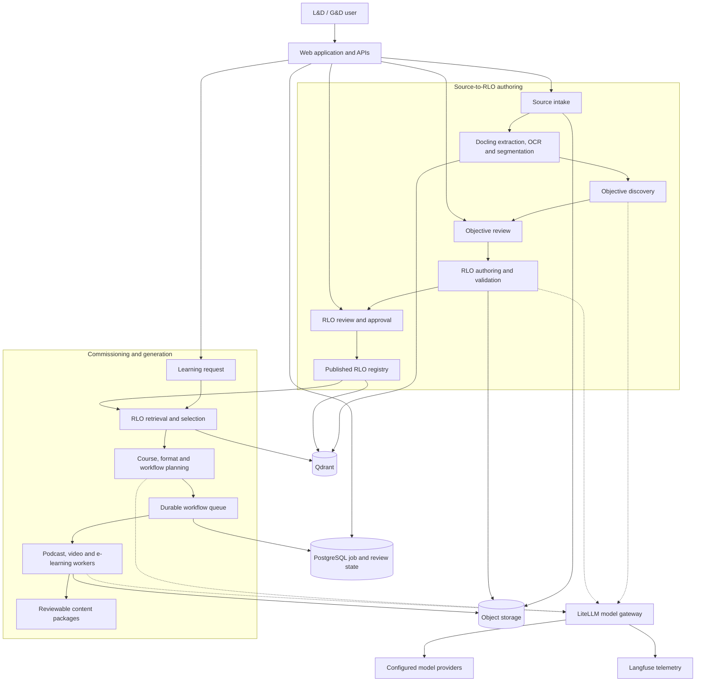

# Omnichannel Learning

Omnichannel Learning is an AI-assisted authoring and production platform for creating reusable learning content from source material. It supports the full path from document intake through learning-objective review, RLO authoring, publication, commissioning, and delivery as podcasts, videos, or e-learning.

The application is designed for L&D and G&D users rather than direct, unreviewed delivery to learners. Human review is part of the workflow: users decide which proposed objectives should be developed and which completed Reusable Learning Objects (RLOs) are ready to publish.

## What the platform does

The platform connects two workflows:

1. **Source-to-RLO authoring**
   - Accept source documents in common business and publishing formats.
   - Extract text, structure, tables, figures, and source locations.
   - Propose performable learning objectives with source evidence.
   - Allow reviewers to approve, revise, reclassify, or reject objectives.
   - Author and validate structured RLOs.
   - Preserve the distinction between source-supported and AI-added content.
   - Publish approved RLOs to a searchable registry.

2. **Commissioning and content generation**
   - Interpret a learning request.
   - Retrieve relevant approved RLOs.
   - Assemble a course blueprint and select a delivery format.
   - Create and execute a structured production plan.
   - Produce reviewable podcasts, avatar videos, Manim animations, and e-learning packages.

The POC authoring scope supports five combinations of content type and cognitive level: Fact × Remember, Concept × Understand, Concept × Apply, Process × Understand, and Procedure × Apply.

## Architecture



The original source remains canonical. Extracted documents, indexes, RLO drafts, planning artifacts, and generated media are derived outputs with retained version and provenance information.

For a fuller explanation, see [Platform Architecture Overview](docs/platform-architecture-overview.md).

## Design approach

### Model-agnostic access

Application code calls purpose-specific aliases such as `source-objective-proposal`, `commissioning-course-assembly`, or `elearning-course-authoring`. Provider model IDs and provider credentials are configured centrally in [`litellm/config.yaml`](litellm/config.yaml).

LiteLLM is the shared model gateway. A model can be changed without rewriting the surrounding workflow, although every replacement still needs to be evaluated for quality, grounding, latency, and token use.

### Model telemetry

LiteLLM sends model telemetry to Langfuse. Calls carry their functional alias and available job, workflow, and task identifiers so activity can be traced across planning, authoring, review, and media generation. Langfuse provides token, latency, status, provider-model, and available cost information at both the call and job level.

See [Langfuse Observability](docs/langfuse.md) for local access and configuration.

### Durable jobs

Document extraction, objective creation, RLO authoring, commissioning, and media generation run asynchronously. PostgreSQL currently acts as both the durable state store and work queue. Workers claim jobs atomically so multiple worker processes do not perform the same work.

This approach is sufficient for the POC. A production build should consider Celery or an equivalent managed queue for independently scaled extraction, planning, authoring, and media workloads. PostgreSQL should remain authoritative for review decisions, provenance, and workflow results even if job transport moves to a dedicated queue.

### Structured execution

Models make instructional and authoring decisions, but they do not define the platform structure. Typed contracts connect RLOs, course blueprints, modality plans, production plans, executable tasks, and final results. Deterministic validation checks references, allowed values, dependencies, and required outputs between stages.

## Repository layout

| Area | Location | Responsibility |
|---|---|---|
| Application and review experience | [`api/`](api/) | Source intake, objective review, RLO review, registry, authentication, and artifact access |
| Source extraction | [`source_content/`](source_content/) and [`api/src/source_ingestion/`](api/src/source_ingestion/) | Docling, OCR, hierarchy, segmentation, quality checks, and source indexing |
| Source-to-RLO authoring | [`api/src/source_authoring/`](api/src/source_authoring/) | Objective discovery, source mapping, RLO drafting, validation, revision, and publication |
| Commissioning | [`src/learning_commissioning/`](src/learning_commissioning/) | Request interpretation, retrieval, curation, course assembly, and generation handoff |
| Content generation | [`src/learning_pipeline/`](src/learning_pipeline/) | Format selection, modality planning, workflow execution, media tools, and packaging |
| Shared model boundary | [`llm_gateway/`](llm_gateway/) and [`litellm/`](litellm/) | Model aliases, common connection settings, telemetry metadata, and provider configuration |
| Shared RLO schema | [`rlo_schema/`](rlo_schema/) | Versioned RLO structures shared by authoring, registry, retrieval, and generation |
| Media runtimes | [`manim/`](manim/), [`src/learning_pipeline/providers/heygen/`](src/learning_pipeline/providers/heygen/), and [`src/learning_pipeline/tools/`](src/learning_pipeline/tools/) | Animation, avatar video, speech, audio assembly, and e-learning packaging |

PostgreSQL stores job and review state. MinIO provides local object storage for sources and generated artifacts. Qdrant provides semantic retrieval for extracted source segments and published RLOs. Nginx exposes the integrated application through one browser entry point.

## Local setup

### Requirements

- Docker Desktop or Docker Engine with Compose
- An OpenAI API key for model-backed workflows
- Google Cloud application-default credentials when using the configured Gemini speech models
- A HeyGen API key and configured avatar/voice profiles only when generating HeyGen video

### Configure the environment

```bash
cp .env.example .env
```

At minimum:

- Set `OPENAI_API_KEY`
- Set `LITELLM_MASTER_KEY` and `LITE_LLM_API_KEY` to the same strong value
- Replace the PostgreSQL, MinIO, POC authentication, and Langfuse development secrets
- Set `DOCKER_PLATFORM` to `linux/arm64` for Apple Silicon or `linux/amd64` for Intel, CI, and the current Azure VM
- Configure Google or HeyGen credentials only for the media capabilities being used

Do not commit `.env` or provider credentials.

### Start the integrated application

```bash
docker compose --profile commissioning up -d --build
```

Add the observability profile when Langfuse is needed:

```bash
docker compose --profile commissioning --profile observability up -d --build
```

The services initialize their database schemas at startup. Check the stack with:

```bash
docker compose ps
curl -fsS http://127.0.0.1:8000/api/health
curl -fsS http://127.0.0.1:4000/health/liveliness
curl -fsS http://127.0.0.1:8080/health/ready
```

### Local endpoints

| Service | URL |
|---|---|
| Integrated application | <http://localhost> |
| Direct application API | <http://localhost:8000> |
| Workflow API | <http://localhost:8080> |
| LiteLLM | <http://localhost:4000> |
| Langfuse, when enabled | <http://localhost:3000> |
| MinIO console | <http://localhost:9001> |
| Qdrant | <http://localhost:6333> |

Use the integrated application through the gateway at `http://localhost`. Directly browsing port 8000 bypasses the gateway and will not provide a complete commissioning experience.

## Tests

Run tests in containers rather than creating a local virtual environment.

Core commissioning and generation tests:

```bash
docker compose --profile workflow run --rm learning-pipeline python -m pytest -q
```

Application and source-authoring tests:

```bash
docker compose --profile test run --rm api-test python -m pytest -q
```

Docling and extraction tests:

```bash
docker compose --profile test run --rm source-extraction-test \
  python -m pytest tests/source_content -q
```

Focused suites may be supplied after the container name using the same pattern.

## Storage and generated artifacts

- `MINIO_BUCKET` stores canonical published RLO documents and uploaded source artifacts.
- `MINIO_ARTIFACT_BUCKET` stores generated media, course packages, planning traces, and provider checkpoints.
- PostgreSQL stores workflow, review, and job state.
- Qdrant stores vector indexes. It is not the source of record for RLO content.
- [`course-definitions/rlos/`](course-definitions/rlos/) contains versioned seed RLOs that are validated and ingested when missing. Published registry content remains in object storage.

Generated artifacts are referenced by the workflow result rather than stored as large database payloads. This allows local MinIO to be replaced with an enterprise object store without changing the instructional contracts.

## Deployment direction

The POC runs the logical services together through Docker Compose. A production build can retain the same boundaries while moving to managed databases and object storage, enterprise identity and secrets, independently scaled worker pools, and a dedicated job broker.

Docling currently runs in a container with local extraction models. A GPU-enabled extraction pool is a potential uplift for image-heavy PDFs, complex layouts, and table processing. It should preserve the same extracted-document contract and be adopted only where benchmarked throughput justifies the additional infrastructure.

For a shared VM deployment:

- Set `DOCKER_PLATFORM=linux/amd64`
- Use strong, environment-specific credentials
- Set `COMMISSIONING_UI_ORIGINS` and `LANGFUSE_URL` to the deployed origin
- Set `POC_AUTH_COOKIE_SECURE=true` when serving over HTTPS
- Retain the named Docker volumes or migrate them deliberately
- Start the same `commissioning` and optional `observability` profiles used locally

## Additional documentation

- [Technical Handoff Guide](docs/technical-handoff-guide.md)
- [Platform Architecture Overview](docs/platform-architecture-overview.md)
- [Langfuse Observability](docs/langfuse.md)
- [Commissioning-to-Generation Pipeline](docs/commissioning-generation-pipeline-plan.md)
- [Five-Combination Objective and Authoring Scope](docs/2026-09-15-poc2-five-cell-objective-authoring-plan.md)
- [RLO Authoring Guidance](docs/rlo-authoring-guidance-by-content-type-and-bloom.md)
- [Tool Abstraction Architecture](docs/architecture-tool-abstraction.md)
