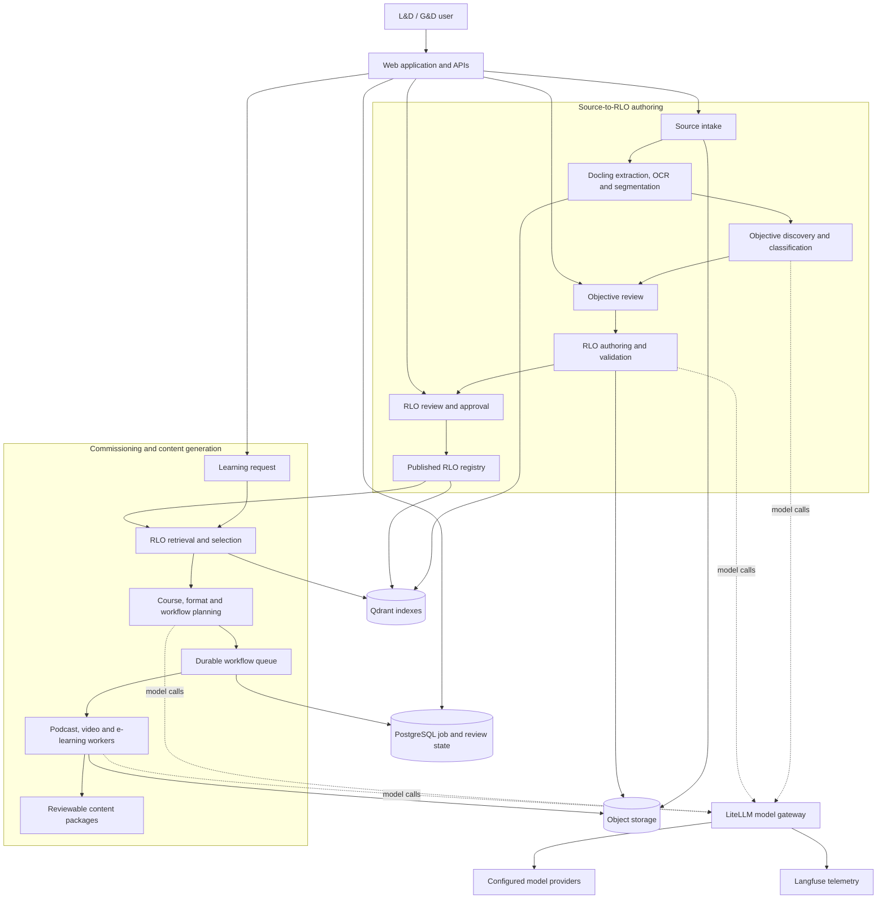

# Omnichannel Learning Platform: Architecture Overview

## Purpose

The platform supports two connected activities. First, it helps a learning team turn source material into reviewed Reusable Learning Objects (RLOs). Second, it can assemble approved RLOs into podcasts, videos, and e-learning.

The current product is an authoring and production tool for L&D and G&D users. It is not designed to generate unreviewed content directly for learners. Human review is therefore part of the workflow: users decide which objectives should proceed and which completed RLOs are ready to publish.

The implementation is broader than a single generation prompt. It preserves the source, intermediate decisions, review history, model activity, and generated outputs so that an item can be inspected, revised, reproduced, or rejected without losing the rest of a job.

## Architecture at a glance

## How the pipeline works

### 1. Source intake and extraction

A user uploads an approved source document. The application stores the original file, records its checksum and version, and creates a durable processing job. Supported formats currently include PDF, Word, PowerPoint, EPUB, HTML, Markdown, and plain text.

Docling performs the main document extraction for complex formats. OCR is applied selectively where a page does not contain a usable text layer. The result is not simply a block of text: the pipeline retains headings, sections, pages or slides, tables, figures, reading order, and stable source identifiers. Long documents are divided along structural boundaries and then into model-sized segments. This avoids treating a model context window as a document parser and allows the complete source to remain available even when no single model call can contain it.

The original document remains canonical. Extracted documents, segments, indexes, and later learning content are derived artifacts that can be regenerated.

### 2. Objective and RLO authoring

The extracted source is analyzed for useful, performable learning objectives. Each proposal retains its relationship to the source and is presented for human review before authoring proceeds.

Approved objectives are expanded into structured RLOs containing instruction, examples, practice, and assessment. Source-supported material remains distinguishable from knowledge or instructional scaffolding added by the model. Automated checks evaluate source grounding, structure, and instructional alignment, but they do not replace the approval decision.

The POC authoring scope supports the five combinations agreed for this phase: Fact × Remember, Concept × Understand, Concept × Apply, Process × Understand, and Procedure × Apply. Keeping this boundary explicit prevents unsupported classifications from being silently forced through authoring.

Approved RLOs are published to the registry and indexed for later retrieval. The registry is the connection between authoring and content generation.

### 3. Commissioning and generation

A commissioning request describes the desired learning outcome and, where applicable, a preferred format. The system interprets the request, retrieves relevant approved RLOs, and proposes a course blueprint. It then selects or confirms a delivery format and creates a structured production plan.

The plan is compiled into an executable dependency graph rather than sent to one large generation call. A podcast, for example, contains separate speech tasks followed by an assembly task. An e-learning may contain screen authoring, assessment, Manim animation, narration, and packaging tasks. This separation allows each step to be validated, retried, and measured independently.

Generated media and packages are stored outside the workflow database. The database retains job state, references, and audit information. Object storage holds the larger source and output files.

## Key design choices

### Model-agnostic model access

Application modules call purpose-specific model aliases such as objective proposal, course assembly, or e-learning authoring. They do not contain provider model IDs or separate provider credentials.

LiteLLM is the common model gateway. It maps each functional alias to a configured provider and model. This makes it possible to change a model, provider, or reasoning setting in one place without rebuilding the surrounding workflow. It does not imply that models are interchangeable without testing: a replacement still needs to be evaluated for output quality, grounding, latency, and token use.

This boundary also keeps model selection separate from business logic. The pipeline describes what a call is for. LiteLLM determines which configured model performs it.

### Model telemetry

Model calls routed through LiteLLM are sent to Langfuse. The telemetry includes the functional model alias, provider model, token use, latency, status, and available cost data. Job, workflow, and task identifiers allow calls from planning, authoring, review, and media generation to be grouped under the user-visible job.

This provides two useful views. Operators can investigate an individual failure or unexpectedly expensive job, while product owners can compare token consumption and performance by pipeline stage. Media services that do not use the model gateway, such as HeyGen rendering, require their own usage records.

### Durable job processing

Extraction, objective creation, RLO authoring, commissioning, and content generation can all outlast an HTTP request. The application therefore records jobs before processing begins and lets background workers claim them. PostgreSQL currently serves as the durable queue and state store. Atomic claims prevent two workers from processing the same job, and completed steps remain available if a later step fails.

This is appropriate for the POC and supports multiple specialized workers. For a production build with larger or more uneven workloads, Celery or an equivalent managed queue should be considered. A dedicated broker and worker pools would make autoscaling, scheduling, retry policy, prioritization, and operational monitoring easier. Extraction, planning, and media rendering should be independently scalable because they have different resource and latency profiles.

The existing job and workflow contracts can remain in place if the transport changes. Celery would move work between services. It would not become the authoritative store for review decisions, provenance, or published content.

### Structured contracts and deterministic checks

The model is used where interpretation and authoring are valuable, but it does not control the platform structure. Typed contracts connect RLOs, course blueprints, modality plans, production plans, executable tasks, and final results. Deterministic validation checks references, allowed values, dependencies, and required outputs between stages.

This combination is intentional. Models provide flexible reasoning and content generation, while code maintains the boundaries needed for repeatability, review, and safe execution.

## Module layout

| Area | Primary location | Responsibility |
|---|---|---|
| Application and review experience | `api/` | Source intake, objective review, RLO review, registry, authentication, and artifact access |
| Source extraction runtime | `source_content/` and `api/src/source_ingestion/` | Docling, OCR, document hierarchy, segmentation, quality checks, and source indexing |
| Source-to-RLO authoring | `api/src/source_authoring/` | Objective discovery, source mapping, RLO drafting, validation, revision, and publication |
| Commissioning | `src/learning_commissioning/` | Request interpretation, RLO retrieval, candidate curation, course assembly, and handoff to generation |
| Content-generation pipeline | `src/learning_pipeline/` | Format selection, modality planning, workflow planning, execution, media tools, and packaging |
| Shared model boundary | `llm_gateway/` and `litellm/` | Functional model aliases, common connection settings, telemetry metadata, and provider configuration |
| Shared RLO contracts | `rlo_schema/` | Stable RLO structures used across authoring, registry, retrieval, and generation |
| Media-specific runtimes | `manim/`, `src/learning_pipeline/providers/heygen/`, and `src/learning_pipeline/tools/` | Animation rendering, avatar-video integration, speech, audio assembly, and e-learning packaging |

PostgreSQL holds operational state and review history. MinIO provides local object storage and can be replaced by an enterprise object store through the storage abstraction. Qdrant provides semantic retrieval for source segments and published RLOs. Nginx exposes the application through one consistent web entry point.

## Scaling the extraction layer

The current Docling container runs locally with pinned extraction models and no required external document-processing service. This protects source boundaries and produces repeatable artifacts, but complex PDFs, tables, figures, and OCR-heavy documents can make extraction compute-intensive.

A potential production uplift is a GPU-enabled extraction worker pool. Docling's layout and table models can use accelerated PyTorch runtimes, so GPU workers may improve throughput for the document classes that need them. The change should preserve the same extracted-document contract and storage layout. Downstream objective and RLO services should not need to know whether CPU or GPU performed the extraction.

This should be benchmarked rather than assumed. Native Word, HTML, and text extraction may gain little from a GPU, while image-heavy PDFs may gain substantially. A sensible production design would route documents according to format and observed complexity, keeping lower-cost CPU workers for straightforward files and reserving GPU capacity for extraction and OCR workloads that demonstrate a measurable benefit.

## Production direction

The POC proves the end-to-end shape of the platform, but its services are deployed together for convenience. A production build can retain the same logical boundaries while separating workloads operationally:

- Independently scaled extraction, authoring, planning, and media worker pools
- Celery or a managed equivalent for distributed job delivery
- GPU capacity for extraction and rendering where benchmarks justify it
- Managed databases, vector storage, and object storage
- Enterprise identity, secrets, monitoring, backup, and recovery
- Versioned prompts, models, rules, source content, and published RLOs

The central architectural assumption is that model behavior will continue to change. The platform therefore keeps models behind a gateway, content behind review gates, and each major stage behind an explicit contract. That allows individual components to improve without turning the full workflow into a new implementation each time.
