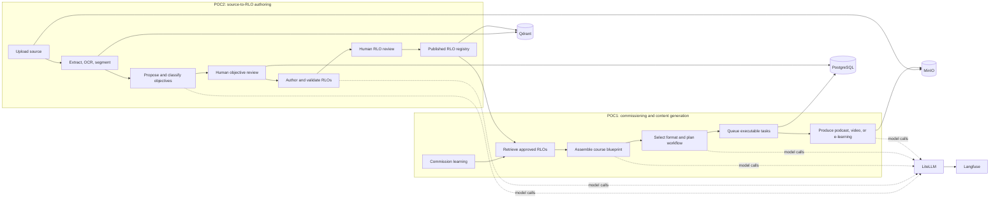

# Technical Handoff Guide

## Purpose

This guide is a practical map of the two proofs of concept and the code that implements them. It is intended to support a technical walkthrough, local setup, and an informed decision about whether to use the repository as a reference or continue building on it.

The two POCs are connected:

- **Content generation (POC1)** turns approved Reusable Learning Objects (RLOs) into podcasts, avatar video, animation, and e-learning.
- **Source-to-RLO authoring (POC2)** turns source documents into reviewed learning objectives and RLOs that can be used by the content-generation workflow.

The current product is an authoring and production tool for L&D and G&D users. It is not a learner-facing application. Human review of objectives and completed RLOs is an intentional part of the current design.

## Architecture at a glance



## POC2: source-to-RLO authoring

### Use case and solution

POC2 addresses the work that happens before content generation. A user uploads source material, the system proposes source-supported learning objectives, and a reviewer decides which objectives should be developed. Approved objectives are authored into seven-part RLOs, checked for grounding and instructional alignment, and reviewed before publication.

The source remains canonical. Extracted structures, model outputs, reviews, and RLOs are derived and versioned artifacts. Source-supported content remains distinguishable from instructional material or knowledge added by the model.

The implemented authoring scope is limited to five combinations of content kind and cognitive demand:

- Fact × Remember
- Concept × Understand
- Concept × Apply
- Process × Understand
- Procedure × Apply

Out-of-scope objectives remain visible for review but cannot silently proceed into authoring.

### End-to-end flow and key code paths

| Stage | What happens | Start here |
|---|---|---|
| Application and routes | Connects source intake, objective jobs, RLO review, registry, and publication | `api/src/app.py`, `api/src/source_upload.py`, `api/src/objective_jobs.py`, `api/src/source_drafts.py` |
| Intake and job state | Stores the original, source/version identity, checksum, and durable extraction job | `api/src/source_ingestion/repository.py`, `api/src/source_ingestion/contracts.py` |
| Extraction | Uses format-specific extraction, Docling for complex documents, selective OCR, hierarchy preservation, and visual explanation | `api/src/source_ingestion/worker.py`, `api/src/source_ingestion/extractors/`, `api/src/source_ingestion/ocr.py`, `api/src/source_ingestion/hierarchy.py` |
| Segmentation and indexing | Splits along document structure, creates bounded model inputs, and indexes source segments | `api/src/source_ingestion/segmentation.py`, `api/src/source_ingestion/source_index.py` |
| Semantic mapping | Builds hierarchy-aware source maps with exact node citations before objective discovery | `api/src/source_authoring/mapping.py` |
| Objective discovery | Finds performance signals, proposes objectives, checks coverage, and classifies them | `api/src/source_authoring/objectives.py`, `api/src/source_authoring/job_service.py` |
| Scope policy | Defines the five supported combinations and deterministic authoring boundary | `api/src/source_authoring/cell_scope.py`, `api/src/source_authoring/methodology.py` |
| Objective review | Persists reviewer decisions and approved workspace revisions | `api/src/source_authoring/job_repository.py`, `api/src/objective_jobs.py` |
| RLO authoring | Maps evidence, creates the seven RLO parts, validates grounding and pedagogy, and retains successful items when another item fails | `api/src/source_authoring/generation.py`, `api/src/source_authoring/drafting.py`, `api/src/source_authoring/draft_repository.py` |
| Revision | Turns selected findings into bounded repair actions rather than automatically rerunning the full analysis | `api/src/source_authoring/revision.py` |
| Publication | Adapts an approved draft to the shared RLO schema, stores it, and indexes it for retrieval | `api/src/source_authoring/catalog_adapter.py`, `api/src/app.py`, `api/src/indexer.py` |

### Prompts and rules

The objective prompts are ordinary, versioned Markdown assets under:

- `api/src/source_authoring/prompts/objective_extraction/`

The RLO authoring, review, enrichment, and repair prompts are under:

- `api/src/source_authoring/prompts/rlo_generation/`

`api/src/source_authoring/prompt_assets.py` loads the assets and records prompt identity, version, digest, model alias, and the exact snapshot used for a job. The most useful rule references for a walkthrough are:

- `docs/rlo-generation-rules-reference.md` — the compressed decomposition, classification, mapping, and validation rules
- `docs/rlo-authoring-guidance-by-content-type-and-bloom.md` — authoring guidance for the five supported combinations
- `docs/2026-09-15-poc2-five-cell-objective-authoring-plan.md` — the scope decision and its implementation
- `docs/rlo-evidence-lineage.md` — how source evidence and added knowledge are represented
- `docs/prompt-catalog.md` — searchable inventory of runtime prompts and their loaders

### Evaluation position and known gaps

The POC demonstrated the complete technical flow from document upload to published RLO. It also demonstrated review, source lineage, partial-failure isolation, bounded revision, and reuse through commissioning. Automated tests cover contracts, extraction, objective processing, authoring, publication, and integration paths.

The handoff should distinguish that result from questions the POC did not resolve:

- A representative governed body of internal source material was not available, so content coverage at enterprise scale remains unknown.
- Objective and RLO review add control but can become an operating bottleneck.
- Content-gap enrichment works technically, but the future authority and review policy for model-added knowledge still needs to be established.
- The five supported authoring combinations are a deliberate POC boundary, not the complete taxonomy described in earlier materials.
- Individually acceptable RLOs can still form a disjointed experience when assembled across sources. Retrieval relevance does not guarantee instructional sequence or consistency.
- Reviewers assessed the product concept and outputs, but the POC did not measure learner comprehension, retention, or workplace transfer.

The most useful executable evidence is under `tests/source_content/`, with route and interface coverage in `api/tests/`. The source-content fixtures include structured, multi-column, and image-only cases. These tests establish contract and workflow behavior; they should not be presented as a substitute for instructional or learner evaluation.

## POC1: commissioning and content generation

### Use case and solution

POC1 starts with approved RLOs. A commissioning request is interpreted, relevant RLOs are retrieved, and a modality-neutral course blueprint sequences the selected material. The system then selects or confirms a format, creates a modality plan, compiles it into a typed task graph, and sends the work to specialized workers.

This is intentionally not one large prompt. Planning, authoring, speech, animation, avatar rendering, assembly, and packaging are separate tasks with explicit contracts. That makes failures easier to isolate and permits different models or providers to be used for different functions.

### End-to-end flow and key code paths

| Stage | What happens | Start here |
|---|---|---|
| Commissioning API | Accepts the request and exposes preview, confirmation, job, and deliverable operations | `src/learning_commissioning/api/app.py` |
| Intent and retrieval | Interprets the request, searches the RLO registry, and builds candidate sets | `src/learning_commissioning/services/interpretation.py`, `src/learning_commissioning/services/retrieval.py` |
| Candidate curation | Applies model-assisted selection without replacing deterministic eligibility and score handling | `src/learning_commissioning/services/curation.py` |
| Course assembly | Sequences selected RLOs into a modality-neutral blueprint with content references | `src/learning_commissioning/services/assembly_runner.py`, `src/learning_pipeline/planners/curriculum/`, `src/learning_pipeline/prompts/curriculum_assembly/` |
| Generation planning | Selects the format, creates a modality plan, and compiles an executable build plan | `src/learning_pipeline/services/generation_planning.py`, `src/learning_pipeline/format_selector/`, `src/learning_pipeline/planners/modality/`, `src/learning_pipeline/planners/workflow/` |
| Durable execution | Claims a workflow, validates the plan, runs its dependency graph, checkpoints progress, and records the result | `src/learning_pipeline/worker/main.py`, `src/learning_pipeline/runtime/runner.py`, `src/learning_pipeline/db/` |
| Tool registration | Defines the production capabilities and maps worker profiles to real executors | `src/learning_pipeline/config.py`, `src/learning_pipeline/tools/catalog.py` |
| Deliverables | Returns stored artifacts and status to the integrated Jobs experience | `src/learning_commissioning/api/app.py`, `src/learning_pipeline/runtime/artifact_store.py` |

### Production modules

| Module | Summary | Primary code |
|---|---|---|
| Content and course planner | Retrieves approved RLO content, creates a course blueprint, chooses a format, and turns modality decisions into a validated production plan. It preserves RLO references rather than asking the model to recreate the source material. | `src/learning_pipeline/planners/`, `src/learning_pipeline/services/generation_planning.py`, `src/learning_pipeline/production.py` |
| E-learning and slide authoring | Converts planned screen requirements into authored screens, knowledge checks, navigation, accessibility metadata, and a reviewable web bundle. Authoring is batched and checkpointed. Current rendering still uses selected components from the earlier `pipeline/` implementation through a narrow bridge. | `src/learning_pipeline/tools/elearning_bundle/`, `pipeline/components/`, `pipeline/src/renderer.py` |
| Manim animation | Turns a bounded visual brief into a template-based or generated Manim scene, synthesizes narration, renders it in an isolated container, and returns media and usage artifacts. Templates are preferred where they fit. | `src/learning_pipeline/tools/manim_video/`, `manim/` |
| HeyGen avatar video | Resolves configured avatar and voice profiles, maps planned scenes to HeyGen requests, checkpoints provider operations, avoids duplicate submissions, downloads completed media, and records provider usage. | `src/learning_pipeline/tools/avatar_video/`, `src/learning_pipeline/providers/heygen/` |
| Podcast builder | Plans host/expert dialogue, creates separate speech tasks, synthesizes WAV segments, preserves declared order and pauses, and assembles the final episode with an auditable usage summary. | `src/learning_pipeline/planners/modality/podcast/`, `src/learning_pipeline/planners/workflow/podcast/`, `src/learning_pipeline/tools/speech/`, `src/learning_pipeline/tools/audio_assembly/` |
| Workflow runtime | Validates the build plan and runs independent tasks in dependency order. Task results and final artifacts are persisted so a failed workflow can be inspected and safely retried. | `src/learning_pipeline/runtime/`, `src/learning_pipeline/worker/`, `src/learning_pipeline/db/` |

### Prompts and rules

The most important POC1 prompt assets are:

- `src/learning_pipeline/prompts/curriculum_assembly/course_assembly.md`
- `src/learning_pipeline/prompts/format_selector/`
- `src/learning_pipeline/prompts/modality_planner/`
- `src/learning_pipeline/prompts/workflow_planner/`
- `src/learning_pipeline/prompts/elearning_author/`
- `src/learning_pipeline/prompts/manim_render/`
- `src/learning_commissioning/services/interpretation.py` and `curation.py` for the two compact commissioning prompts

`docs/prompt-catalog.md` explains each prompt, its loader, and its role. The deterministic tool and plan constraints are as important as the prose prompts; see `src/learning_pipeline/contracts/`, `src/learning_pipeline/validation/`, and `src/learning_pipeline/affordances/`.

### Evaluation position and known gaps

The POC demonstrated planning and production for podcasts, avatar video, Manim animation, and e-learning, including persistent jobs and downloadable results. Reference-mode fixtures and automated tests exercise the same plan contracts without consuming provider services.

The main forward-looking considerations are:

- Course coherence across independently authored RLOs requires an explicit pathway-level quality step.
- Media quality, generation time, and token or provider usage vary with the requested format and length.
- Production scaling should separate planning, extraction, e-learning, animation, avatar video, and speech worker pools.
- Provider-backed generation needs idempotency, timeout, retry, and usage controls. The current implementation establishes these patterns but is not a full enterprise operations model.

The most useful executable evidence is organized under `tests/commissioning/`, `tests/planners/`, `tests/validation/`, `tests/execution/`, and `tests/tools/`. `tests/end_to_end/` and the reference fixtures demonstrate complete plans without requiring paid providers. Media tests validate contracts and orchestration; they do not establish that every generated asset will meet a learning-design or production-quality standard.

## Shared infrastructure

| Component | Role in this repository |
|---|---|
| Nginx gateway | Presents the integrated application on one origin and routes browser and API traffic to the appropriate service. |
| LiteLLM | Common model gateway. Application code uses functional aliases while provider model IDs, credentials, and settings remain in `litellm/config.yaml`. |
| Langfuse | Captures model traces, token use, latency, status, and available cost data. Job and task metadata connect model calls to user-visible work. |
| ClickHouse | Stores high-volume Langfuse event and analytical data. It is observability infrastructure, not application content storage. |
| Langfuse PostgreSQL | Stores Langfuse application and configuration data separately from pipeline state. |
| Redis | Supports Langfuse background processing and short-lived queue/cache needs. It is not the repository's primary workflow queue. |
| Application PostgreSQL | Stores source, extraction, objective, review, draft, and publication state. In the Compose environment the source-authoring services share the workflow database. |
| Workflow PostgreSQL | Stores commissioning jobs, executable workflow state, task checkpoints, and results. It currently also provides durable work claiming. |
| LiteLLM PostgreSQL | Stores LiteLLM proxy state such as virtual keys and configuration data. |
| Qdrant | Holds vector indexes for source segments and published RLOs. Object storage remains the source of record. |
| MinIO | Local S3-compatible storage for uploaded sources, published RLO JSON, planning traces, generated media, packages, and provider checkpoints. |
| Docling | Extracts structured content from complex documents while retaining hierarchy, tables, figures, and location information. |
| Manim renderer | Runs animation and narration rendering in an isolated image with bounded compute and filesystem access. |

## Shared model and telemetry boundary

`llm_gateway/__init__.py` is the shared application boundary for model aliases, LiteLLM connection settings, Langfuse headers, and trace metadata. Provider model IDs should appear only in `litellm/config.yaml`.

This separation makes the implementation model-agnostic at the application layer. It does not make model substitutions risk-free. Any change still needs quality, grounding, latency, and token-use evaluation for the affected function.

## Setup and verification

The main setup instructions are in `README.md`. The shortest local path is:

```bash
cp .env.example .env
docker compose --profile commissioning --profile observability up -d --build
docker compose ps
curl -fsS http://127.0.0.1:8000/api/health
curl -fsS http://127.0.0.1:4000/health/liveliness
curl -fsS http://127.0.0.1:8080/health/ready
```

Use the application through `http://localhost`, not the direct API port. Provider-backed workflows require the corresponding credentials and profile IDs described in `.env.example` and `README.md`.

Run verification in containers:

```bash
docker compose --profile workflow run --rm learning-pipeline python -m pytest -q
docker compose --profile test run --rm api-test python -m pytest -q
docker compose --profile test run --rm source-extraction-test \
  python -m pytest tests/source_content -q
```

## Current and compatibility paths

The primary implementation is under `api/src/`, `src/learning_commissioning/`, and `src/learning_pipeline/`.

The top-level `pipeline/` directory is older, but it is not wholly dead. The current e-learning bundle loads its renderer, schema, and component library through `src/learning_pipeline/tools/elearning_bundle/_pipeline_bridge.py`. Its standalone `generate` Compose profile and compatibility tests also preserve earlier entry points. Do not remove the directory as a general cleanup without first replacing that bridge and deciding whether compatibility remains a requirement.

The top-level `heygen/video_renderer.py` is a legacy command-line adapter over the current provider layer. The runtime HeyGen implementation is under `src/learning_pipeline/providers/heygen/` and `src/learning_pipeline/tools/avatar_video/`.
