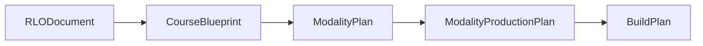

# Reference Fixtures — ADKAR Podcast Learning Journey

These files are manually authored, contract-valid examples of the data exchanged
between each architectural stage of the Personalized Learning Workflow.

They are **not** planner outputs. They represent the expected shape and level of
detail that future LLM-driven planners must produce. Future planner outputs need
not match the wording here — they must conform to the same contracts and pass the
same structural validation.

---

## Scenario

| Attribute | Value |
|---|---|
| RLO | `rlo-adkar-01-name-and-sequence` v1.1.0 |
| Role | Manager |
| Deloitte level | 55 |
| Starting ADKAR proficiency | beginner |
| Target ADKAR proficiency | intermediate |
| Content depth | working |
| Modality | podcast |
| Estimated duration | 10 minutes |

**Learning goal:** Recognize the five ADKAR elements in the correct order and
distinguish Awareness from Ability.

---

## Contract flow



---

## Files

### RLO — canonical source (not duplicated here)

The source RLO is:

```
course-definitions/rlos/rlo-adkar-01-name-and-sequence.json
```

**Created by:** RLO ingestion (offline authoring)  
**Consumed by:** CurriculumPlanner → CourseBlueprint

The RLO is the system of record. No fixture here duplicates or modifies it.

---

### `learner_context.json`

**Contract:** `LearnerContext`  
**Created by:** Caller (API request, session context)  
**Consumed by:** CurriculumPlanner to personalise the CourseBlueprint

A standalone representation of the learner profile used in this scenario.
The same data is embedded inside `course_blueprint.json` under the `learner` key.

---

### `course_blueprint.json`

**Contract:** `CourseBlueprint`  
**Created by:** CurriculumPlanner  
**Consumed by:** ModalityContextResolver → ModalityPlanningContext → ModalityPlanner

Personalises the RLO for the target learner. Contains:

- A `TailoredRLORef` referencing `rlo-adkar-01-name-and-sequence` at exact version `1.1.0`
- Selected content: objective `lo-01`, concept `c-01`, six components, and two assessment items
- Proficiency progression: beginner → intermediate
- Role relevance and personalisation rationale for a Level 55 Manager
- Sequencing and assessment strategy

Does not contain rendered content, modality-specific structures, or production details.

---

### `modality_plan.json`

**Contract:** `ModalityPlan`  
**Created by:** ModalityPlanner  
**Consumed by:** WorkflowPlanner → ModalityProductionPlan

Describes the two-segment podcast structure. Each scene declares:

- A learning objective
- A teaching pattern
- Source content references back to the canonical RLO (by ID + version)
- A content direction for the generation step
- A target duration

**Scene 1 — `scene-intro-adkar`:** Introduces ADKAR using the hook, core rule,
and mnemonic example. Teaching pattern: `hook_then_rule_then_example`.

**Scene 2 — `scene-two-as`:** Disambiguates the two A elements using a contrast
example, a wrong-word non-example, a recall prompt, and two assessment questions.
Teaching pattern: `example_nonexample_then_recall`.

---

### `production_plan.json`

**Contract:** `ModalityProductionPlan`  
**Created by:** WorkflowPlanner  
**Consumed by:** ProductionCompiler → BuildPlan

Three production jobs:

| Job | Capability | Depends on | Deliverable |
|---|---|---|---|
| `speech-segment-1` | `narration` | — | no |
| `speech-segment-2` | `narration` | — | no |
| `assemble-podcast` | `audio_assembly` | both speech jobs | **yes** |

The two speech jobs are independent and can run in parallel.
The assembly job receives both `audio_file` outputs via `task_output` bindings.

---

### `build_plan.json`

**Contract:** `BuildPlan`  
**Created by:** ProductionCompiler  
**Consumed by:** DAGRunner

The concrete, executable task DAG. Abstract capabilities are mapped to executor
task types:

| Capability | Task type |
|---|---|
| `narration` | `speech.synthesize` |
| `audio_assembly` | `audio.assemble` |

The graph structure:

```
speech-segment-1 ─┐
                  ├─→ assemble-podcast  (deliverable)
speech-segment-2 ─┘
```

This plan contains no cycles, no LLM invocation tasks, and no vendor-specific
identifiers. It is intended for later execution with fake executors that can
stand in for `speech.synthesize` and `audio.assemble` during development.

---

## Assumptions

1. **Capability name `narration`** — No capability registry existed at the time
   these fixtures were authored. `narration` was chosen as a clear, modality-neutral
   name for single-voice speech synthesis. If the project defines a different
   capability name, update the `preferred_capability` field in `modality_plan.json`
   and the `capability` fields in `production_plan.json` accordingly.

2. **Capability name `audio_assembly`** — Similarly assumed. If the project uses
   a different name for the multi-segment audio joining step, update
   `production_plan.json`.

3. **Task type `speech.synthesize`** — Temporary executor task type assumed for
   the build plan. The existing sample plan uses `local.emit` and `local.concat`
   as examples. No permanent executor registry entry is implied.

4. **Task type `audio.assemble`** — Same assumption as above.

5. **`scene_id` input key** — Each speech task receives a `scene_id` literal
   input identifying which modality scene's content to synthesise. This input
   key is assumed; a real executor may use a different key name or accept a
   pre-rendered script instead.

6. **RLO not duplicated** — The RLO fixture file (`rlo-adkar-01-name-and-sequence.json`)
   is not copied into this directory. All references use IDs and the version
   `1.1.0` from the canonical file.

---

## Validation

All fixtures are validated by the test suite:

```bash
python3 -m pytest tests/contracts/test_podcast_reference_fixtures.py -v
```

The tests verify:
- Every fixture parses against its contract
- RLO ID and version agree across all fixtures
- All selected content IDs exist in the canonical RLO
- All modality-scene source references are valid
- All production-job scene references are valid
- Build-plan dependency graph is well-formed and acyclic
- Task-output bindings reference declared upstream outputs
- The two speech tasks are mutually independent
- Assembly depends on both speech tasks
- Assembly is the only deliverable task
