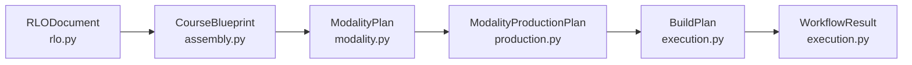

# Learning Pipeline — Domain Contracts

This package defines the immutable data contracts that cross module boundaries.
All types are Pydantic v2 `FrozenModel` (frozen, `extra="forbid"`).

## Six-Stage Flow



| Stage | Contract | Created by | Consumed by |
|-------|----------|-----------|-------------|
| 1 | `RLODocument` | RLO ingestion | Curriculum assembly, ModalityContextResolver |
| 2 | `CourseBlueprint` | CurriculumPlanner | ModalityContextResolver, WorkflowPlanner |
| 3 | `ModalityPlan` | ModalityPlanner | WorkflowPlanner |
| 4 | `ModalityProductionPlan` | WorkflowPlanner | ProductionCompiler |
| 5 | `BuildPlan` | ProductionCompiler | DAGRunner |
| 6 | `WorkflowResult` | DAGRunner | Delivery layer |

## Sub-modules

| Module | Contents |
|--------|----------|
| `common.py` | `FrozenModel`, `Modality`, `TopicProficiency`, `ContentDepth`, `PROFICIENCY_ORDER`, `LiteralInput`, `TaskOutputInput`, `InputBinding` |
| `rlo.py` | `RLODocument` and all nested RLO types |
| `learner.py` | `LearnerContext` |
| `assembly.py` | `RLOContentSelection`, `TailoredRLORef`, `CourseBlueprint` |
| `modality.py` | `RLOContentRef`, `ModalityScene`, `ModalityPlan`, `PresentationCapability` |
| `production.py` | `ProductionJob`, `ModalityProductionPlan` |
| `execution.py` | `TaskSpec`, `BuildPlan`, `TaskResult`, `WorkflowResult` |

## Validation model

Three tiers of validation apply to every contract:

```
Pydantic model validation
    → Validates one object locally (field types, value constraints, internal
      consistency such as proficiency ordering and unique RLO orders).

Cross-contract validation   (learning_pipeline.validation)
    → Validates relationships between objects — e.g. that a modality scene
      only references content selected in the CourseBlueprint, or that a
      production job's dependencies form a valid DAG.

Runtime validation          (future)
    → Verifies that actual executor outputs match the declared output_keys.
```

### Validation order

```
validate_course_blueprint(blueprint, rlos)
    → validate_modality_plan(modality_plan, blueprint, rlos, allowed_capabilities)
    → validate_production_plan(production_plan, modality_plan, supported_capabilities)
    → validate_build_plan(build_plan, registered_task_types)
    → execute
```

All cross-contract validators raise `CrossContractValidationError` (or the
legacy `PlanValidationError` subclass for the build plan) with a stable `code`
attribute so callers can branch on error type without parsing prose messages.

## Import convention

Consumers should import from the package root:

```python
from learning_pipeline.contracts import RLODocument, CourseBlueprint, ModalityPlan
```

Internal modules that need only a narrow subset may import directly from a sub-module:

```python
from learning_pipeline.contracts.common import FrozenModel
```
